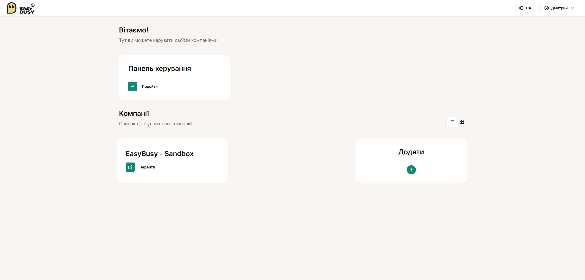
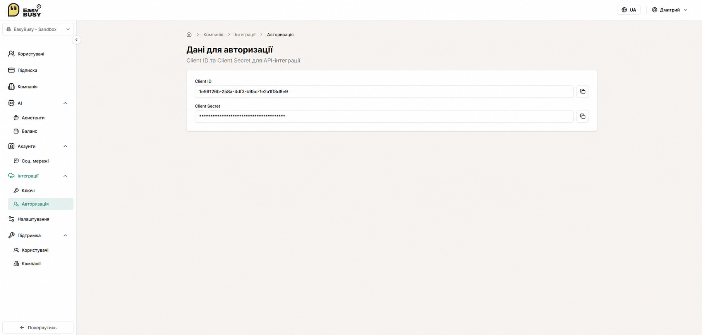
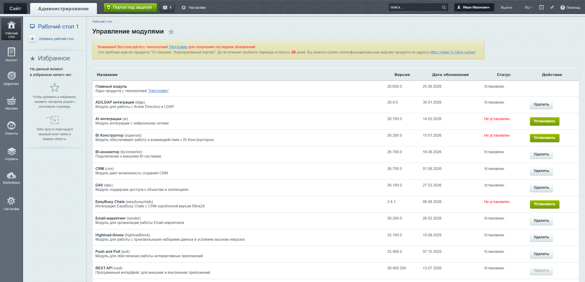
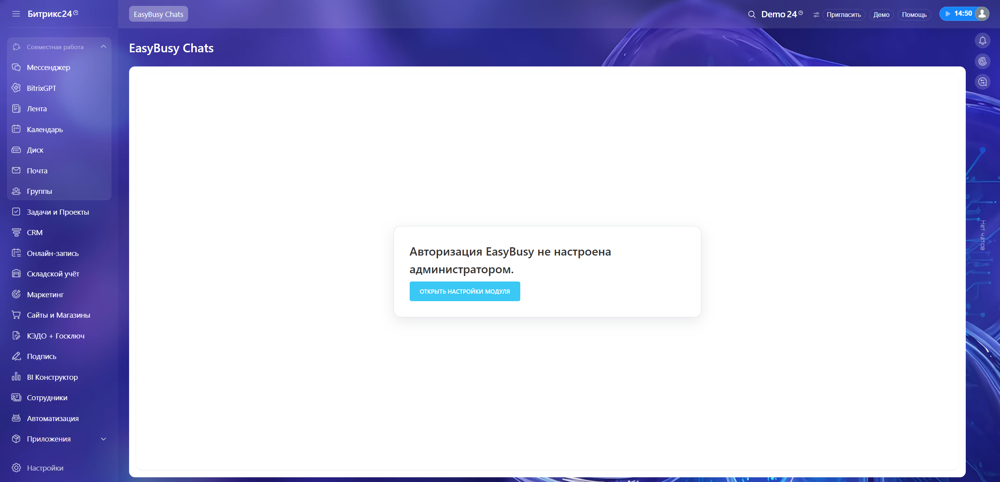
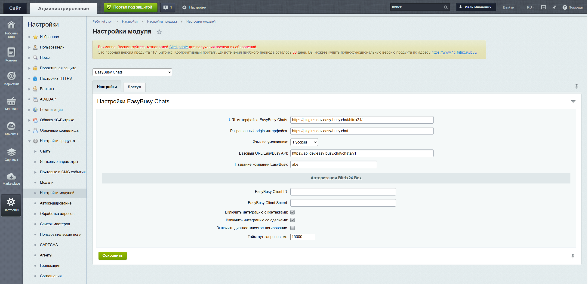
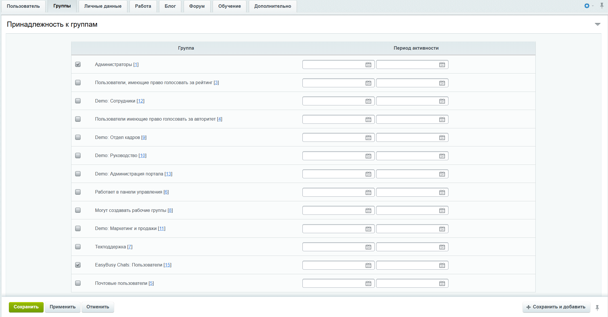

# Установка и настройка EasyBusy Chats в Bitrix24 Box

Эта инструкция предназначена для администратора коробочного Bitrix24. Для установки потребуются:

- права администратора Bitrix24;
- доступ к нужной компании в EasyBusy;
- `Client ID` и `Client Secret` этой компании;
- архив модуля `easybusychats`.

> **Важно:** не публикуйте `Client Secret` в Git, документации, скриншотах, чатах и журналах. Если секрет был раскрыт, выпустите новый и замените его в настройках модуля.

## 1. Выберите компанию в EasyBusy

Войдите в EasyBusy, перейдите в **Панель управления** и выберите компанию, которую необходимо связать с Bitrix24. В приведённом примере используется компания **EasyBusy - Sandbox**.



Запомните точное название компании. Оно потребуется при настройке модуля в Bitrix24.

## 2. Получите Client ID и Client Secret

В панели выбранной компании откройте **Интеграции → Авторизация**. Скопируйте значения:

- **Client ID**;
- **Client Secret**.



`Client Secret` показывайте и передавайте только администратору, выполняющему настройку Bitrix24.

## 3. Разместите модуль в Bitrix24

Скачайте нужную версию модуля со страницы [тегов репозитория EasyBusy Box24](https://github.com/EasyBusy-LLC/box24/tags).

Распакуйте архив и скопируйте каталог `easybusychats` в каталог локальных модулей Bitrix24:

```text
<DOCUMENT_ROOT>/local/modules/easybusychats
```

Итоговая структура должна содержать файл:

```text
<DOCUMENT_ROOT>/local/modules/easybusychats/install/index.php
```

Не допускайте лишней вложенности вида:

```text
<DOCUMENT_ROOT>/local/modules/easybusychats/easybusychats
```

Рекомендуемые права доступа: `755` для каталогов и `644` для файлов. Пользователь PHP-FPM должен иметь возможность читать файлы модуля.

## 4. Установите модуль

Войдите в Bitrix24 под администратором и откройте страницу управления модулями:

```text
https://<BITRIX24_DOMAIN>/bitrix/admin/module_admin.php?lang=ru
```

Найдите строку **EasyBusy Chats (easybusychats)** и нажмите **Установить**.



После успешной установки в левом меню рабочей зоны Bitrix24 появится пункт **EasyBusy Chats**.

## 5. Откройте настройки модуля

Перейдите в **EasyBusy Chats** в левом меню. Если авторизация ещё не настроена, появится соответствующее сообщение. Нажмите **Открыть настройки модуля**.



Настройки также доступны в административной части Bitrix24: **Настройки → Настройки продукта → Настройки модулей → EasyBusy Chats**.

## 6. Настройте подключение

В настройках модуля заполните:

- **Название компании EasyBusy** — точное название выбранной компании, например `EasyBusy - Sandbox`;
- **EasyBusy Client ID** — значение из панели EasyBusy;
- **EasyBusy Client Secret** — значение из панели EasyBusy.

Нажмите **Сохранить**.



Адреса frontend и API уже входят в поставку модуля. Не изменяйте их без отдельной инструкции EasyBusy.

## 7. Предоставьте пользователям доступ

При установке модуль создаёт группу Bitrix24:

```text
EasyBusy Chats: Пользователи
```

Администратор, установивший модуль, получает доступ автоматически. Чтобы предоставить доступ другому сотруднику:

1. откройте карточку пользователя в административной части Bitrix24;
2. перейдите на вкладку **Группы**;
3. включите группу **EasyBusy Chats: Пользователи**;
4. сохраните изменения.

Чтобы отозвать доступ, удалите пользователя из этой группы.



## 8. Проверьте email пользователя

Email пользователя в Bitrix24 Box должен полностью совпадать с email пользователя в выбранной компании EasyBusy. По этому email EasyBusy автоматически определяет, под каким пользователем выполнить вход.

Например:

```text
Bitrix24: user@example.com
EasyBusy: user@example.com
```

Если email не совпадает или пользователь не добавлен в выбранную компанию EasyBusy, авторизация завершится сообщением о том, что пользователь в компании не найден.

## 9. Проверьте результат

1. Обновите страницу Bitrix24 или войдите повторно.
2. Откройте **EasyBusy Chats** в левом меню.
3. Убедитесь, что интерфейс чатов загрузился без ошибки авторизации.

Если пункт меню не отображается, проверьте членство пользователя в группе **EasyBusy Chats: Пользователи**. Если EasyBusy сообщает, что пользователь не найден, проверьте совпадение email и выбранную компанию.

